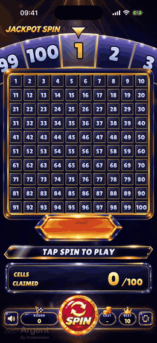

# Jackpot Spin

A 10×10 "claim the board" slot game for iOS and Android, built with React Native, Skia, Reanimated 4 and WebGPU (TypeGPU).

You spin a prize wheel of the numbers 1–100. It brakes on a random number; the number lifts out of the wheel's window and is thrown in an arc onto its key on the board. The key is a sealed vault lid: it flips open into a gold setting and the **treasure hidden under it rises out**, is presented to you (bigger and longer the rarer it is), then drops back and is seated in the cell while coins fly into the "cells claimed" counter. Open all 100 vaults to hit the jackpot.

Two skins share one layout; **tap the logo to switch** (the choice persists):

- **Neon Royale** (default): the original concept. Violet stage, a magenta jewel window on the wheel and a magenta SPIN jewel, gold trim.
- **Royal Treasure**: midnight sapphire, polished gold and a single ruby accent.

A fanned prize wheel with gold crown and base mouldings crowns a gold-framed board of vault keys; below it sit a hexagon result plate, a message banner, an odometer counter plaque and a control bar with the SPIN jewel in the thumb zone.

<p align="center"></p>

Full demo **with sound** (Release build, iPhone 17 Pro simulator, 57 s, 60 fps, perf overlay on): [`docs/demo.mp4`](docs/demo.mp4). It shows two tap spins on a fresh board, the QA fill below opening 99 vaults at once, the jackpot on the last cell and the new-board wave. The green line under the logo is the in-app perf overlay (UI-thread fps, JS-thread fps, long frames, scene renders). The video was captured from the Simulator window together with the Mac's audio output, so it includes the reel ticks, the lock, the win stings and the music.

---

## How to run

```bash
npm install
npx expo run:ios        # or: npx expo run:android  (dev build; Expo Go cannot load WebGPU)
npm test                # reel physics + treasure deal unit tests
npm run typecheck && npm run lint
```

QA helpers:

- **Long-press the logo.** Toggles the performance overlay: UI-thread fps, JS fps, long frames, and how many times the Skia scene re-rendered in React.
- **Long-press the ROUND pill.** Claims 99 cells and rigs the next spin onto the last free one, so you can see the jackpot in one spin.
- **Dev builds only:** `globalThis.__qa` in the JS debugger: `forceNext(n)` rigs the next spin onto cell `n`, `cellsHolding('chest')` lists the cells hiding a treasure, `slowmo(0.25)` slows the whole game clock for frame-by-frame review, `reset()` wipes the saved game back to a first launch. These and the ROUND long-press are the only places a result is ever forced.

---

## Architecture

```
App ─ GestureHandlerRootView ─ GameScreen
                                ├─ Stage     one full-screen Skia <Canvas>: the whole game scene
                                ├─ GoldDust  one transparent WebGPU <Canvas>: GPU particles + HDR bloom
                                └─ Hud       invisible hit targets, pill read-outs, a11y tree

useSpinEngine  (UI thread)          useGameStore (Zustand + AsyncStorage)
  frame loop, state machine,          claimed cells, history, round, settings
  gestures, reveal timeline           written once per spin
        │
        └── shared values ──► sprite systems (one frame callback each) ──► Skia Atlas draws
```

### 1. One game loop on the UI thread

`src/engine/useSpinEngine.ts` is a single `useFrameCallback` worklet. Every frame it advances:

- **the wheel state machine:** `Idle → WindUp → Spin → (Handoff) → Settle → Idle`, plus `Drag`/`Snap` for touch;
- **the reveal timeline** (`Reveal` in `timeline.ts`), one clock in ms after the lock:

  | ms | beat |
  |---|---|
  | 0 | lock: pointer bounce, window flash, light rays |
  | 90–300 | the number lifts out of the window |
  | 300–780 | it is thrown in an arc onto its key; the key pulses as a target |
  | 780–850 | **hit-stop**: ambient time freezes for 70 ms; light blooms out of the cell |
  | 850 | impact: key flips → gold, ripple through the board, sparks and embers, rings, glints, "+1", GPU dust; 14 Blender-simulated coins erupt from the key, bounce and skid on the board, then melt into light |
  | 870 | the result is committed to the store (one JS round-trip) |
  | 950–1900 | a few coins hop into the counter; the odometer rolls when the first lands |
  | 1000 | completed row / column / diagonal: light chases along the line |
  | 3000 | steady |

- **presentation channels** (dim, button morph, press, chase lights, tension, odometer), smoothed with frame-rate-independent exponential approach (`1 − e^(−dt/τ)`).

Rendering components never hold game state. They derive everything from these shared values, so the wheel, the flying number, the key and the counter cannot drift apart. Celebrations never block: tapping during the flight skips to the impact, and a new spin settles any pending reward first.

**React renders per spin: 2** (spin start and result commit), and the Skia scene component does **not** re-render for a normal spin at all. The "scene renders" counter in the perf overlay shows this. During a spin nothing crosses to the JS thread except fire-and-forget `scheduleOnRN` calls for haptics and sound.

### 2. A small sprite engine on Skia Atlas (`src/engine/sprites/`)

Everything that moves is a sprite batch:

- A **layer** is a flat structure-of-arrays `number[]` in one Reanimated mutable: `[x, y, scale, rotation, frame, r, g, b, a]` per sprite.
- A **system** is one `useFrameCallback` that writes its layers in place (`sv.modify(fn, true)`), with no allocation per frame.
- `SpriteLayer` turns a layer into Skia `Atlas` buffers (`useRSXformBuffer`, `useRectBuffer`, `useColorBuffer`). Sprites are centre-anchored, tinted per sprite with `colorBlendMode="modulate"`, and hidden with a zero transform.
- **Textures** are recorded once as `SkPicture`s on the JS thread and rasterised on the UI thread with `usePictureAsTexture`. Glyphs are baked white-to-grey with a dark outline, so one glyph can be tinted gold, silver or white per frame.

| System | Sprites | Draws |
|---|---|---|
| Board (`Tiles.tsx`) | 100 halo + 100 keys + 100 numbers + 200 rim/shine | 4 |
| Wheel (`ArcReel.tsx`) | 11 plates, 34 rim bulbs, numbers + rotational motion-blur ghosts, out-of-focus copies for the flanks | 5 + a few vector paths |
| Flying number (`FlyNumber.tsx`) | one crisp number + an 18-sprite comet tail of light | 2 |
| Particles (`Particles.tsx`) | 220 additive (sparks, glints, embers, rings) + 130 solid (coins, confetti, "+1") | 2 |
| Physical coins (`CoinPhysics.tsx`) | up to 48 coins + contact shadows + glints, from a baked Blender rigid-body sim | 3 |
| Result plate, bokeh motes | 3 + 28 | 2 |
| Loot beam (`LootBeam.tsx`) | outer scatter + column + white core, from a Blender flipbook | 1 |
| Room (`Backdrop.tsx`) | none: one SkSL fragment shader over the full screen | 1 |

The board does a lot with those 4 draws, all as pure functions of the clock:

- **intro:** the keys cascade in along the diagonals with a springy pop;
- **attract:** a glint sweeps across the board every 7 s while idle;
- **scanner:** the key under the pointer lights up and fades, so a magenta comet races across the board in step with the wheel and crawls cell by cell as it brakes;
- **claim:** the 24-frame Blender flip, then a damped radial ripple that pushes the neighbouring keys away from the hit;
- **repeat:** an already-claimed key shakes its head;
- **lines and jackpot:** a light chase along completed lines; a pop wave from the centre on a full board;
- **new board:** keys flip back gold → violet in a wave from the centre.

The wheel's motion blur is **rotational**: each number is drawn with ghost copies trailing along the arc, offset by its angular velocity, so it smears the way it travels at no offscreen-pass cost. The flanks also have **depth of field**, shaped like a real lens rather than a fade:

- **Circle of confusion.** Each slot's blur follows `1 − cos θ` of its angle on the wheel (how far it sits behind the focal plane), so the neighbours of the pointer are barely soft and the far flanks melt. The lens "opens" with speed: a shallow focus at rest, the full depth at blur speed. Reduce Motion keeps a gentle fixed amount.
- **Two blur levels, no runtime blur on the sprites.** The atlas holds two out-of-focus copies of every plate and number (σ ≈ 1.6 pt and 4.6 pt for plates), blurred once at build time and stored at half resolution, then drawn at 2×. Each slot blends sharp → soft → softer on opaque layers, so a half-blurred number never shows a double edge.
- **Bokeh bulbs.** The rim bulbs swell into soft discs as they defocus, and dim as they spread (energy conserved), the way out-of-focus lights do.
- **The rim follows.** The gold rim is split into depth zones; the outer zones are drawn through a Skia blur whose radius tracks the same circle of confusion.

Static chrome (board frame, panels, pills, lettering) is nine-sliced into **two `SkPicture`s** recorded once per layout. The painted panels keep their bevels and ornaments at any phone size.

### 3. Wheel physics (`src/game/reelMath.ts`, unit-tested)

- **Cruise, then crawl.** A tap spin is two curves joined with matching velocity, so there is no visible seam:
  - *cruise* (≈2.3–2.9 s): `(1−h)·E(u) + h·u²(2−u)`, where `E(u) = 15u² − 40u³ + 45u⁴ − 24u⁵ + 5u⁶` has a Beta(2,5) velocity (starts from rest, peaks early at u = 0.2). The blend ends at a readable 5.5 slots/s instead of zero. It is monotonic for 0 ≤ h ≤ 1;
  - *crawl* (2.7 s): the last 8 numbers on the hand-off quintic. They tick past slower and slower: ≈180 ms each at first, ≈290 ms for the second-last, then ≈420 ms for the last one;
  - *the struggle*: the last two pins press against the pointer's flapper. The wheel nearly stalls, then the pin slips past and it lurches on. This is a Gaussian dip added to the position, with its slope kept above −1 so the wheel never runs backwards (tested).
- **Honest.** The result is drawn when the spin starts and the crawl always ends on it. The tension comes from timing, and there is no fake near-miss.
- **Anticipation.** A 200 ms wind-up pulls the wheel back before launch.
- **The pointer is a physical flapper.** It is a torsional spring (8.5 Hz, ζ = 0.16) simulated on the UI thread:
  - each pin bends it along a contact curve and then releases it, so it twangs back with a wobble;
  - at blur speed it rides bent back and rattles;
  - it also squashes and stretches on each pin (a 6 Hz spring), flashes white-hot, trembles once the result is close, and slams down with a flash on lock.
- **Detent settle.** The wheel overshoots the notch and an under-damped spring pulls it back. The "lock" haptic fires on the first notch crossing.
- **Flick to spin.** The finger's velocity is handed to a quintic curve with matching position, velocity and acceleration, so the release has no visible jerk. The curve is monotonic for `V ≤ 2.5·D`, and the tests verify this.
- **Slam-stop.** Tap STOP, or tap the wheel, while it spins. The result is decided at spin start, so stopping only shortens the time to reach it. Above 25 slots/s the numbers are an unreadable blur, so the wheel is re-phased by a whole number of slots (the standard video-slot technique). Deceleration is honest: there is no fake near-miss.
- **Suspense** is a pure function of the wheel's real speed: as the numbers become readable the room dims around the window, the HUD fades back, the camera leans in (below) and the banner says "HERE IT COMES…". Every spin builds the same way.

### 3b. The camera (`src/components/stage/camera.ts`)

One virtual camera frames the world (wheel, board, flying number, particles). The HUD (plate, banner, counter, controls) is screen space and never moves, so every touch target stays where the finger expects it. The camera has no timers: each frame it is a function of the engine state (`tension`, the reveal clock, the result tier).

| Beat | Shot |
| --- | --- |
| Suspense (wheel crawling through readable numbers) | Dolly in on the pointer, up to 1.06× (it never crops the board). Each pin that clunks past the pointer bumps the frame; a heartbeat (its rate rises with tension) breathes in the zoom; a slight handheld sway keeps it alive. The detent haptics escalate with it: selection → light → medium. |
| Lock | Crash zoom: +2.5 %, +5 % for the jackpot. An already-claimed number gets no crash; the camera just exhales. |
| Flight | The camera pans with the number from the pointer to its cell (ease-in-out). |
| Impact | An extra punch-in snaps on for the 70 ms hit-stop (the frozen impact frame), then a damped spring (ω = 15 rad/s, ζ = 0.6) releases the camera to 1× with one firm overshoot, while trauma-based shake (amplitude = trauma², three incommensurate sines, 7 px / 1° at most) rolls the frame. |

Every channel (zoom, pan, hand-held sway) follows its target on a critically damped spring, so the shots join without a kink in velocity; only the impact frame cuts, on purpose. The impact shake runs at 4–9 Hz so it reads as a heavy camera rolling with the hit, not a buzz.

The backdrop takes 35 % of the camera's zoom and shake (parallax: it is far away) and is overscanned 3.5 % so its edges never show. Reduce Motion turns the camera off.

### 3c. The room: a live SkSL shader (`src/components/stage/Backdrop.tsx`)

There is no painted background. The room is one Skia `RuntimeEffect` fragment shader, lit every frame from the engine's shared values:

- **Haze and moving heads.** Two octaves of value noise drift upward as haze. Four stage lights sit just above the top edge, each a soft cone on a lazy pendulum, with a bloom where the lamp spills over the edge. The cones light the haze, so the light reads as volume, not as a gradient.
- **Driven by the game.** The cones sweep faster as the wheel speeds up (they follow the engine's integrated chase phase, so they never jump), and dim with the suspense.
- **The reward.** On a claim all four lights swing onto the winning cell and take the treasure's colour, a flash of that colour blooms from the cell, and a ring of light races out across the room. Rarer finds get brighter, longer holds. On the jackpot the lights converge on the board centre.
- **Finish.** Two depth layers of bokeh rise slowly and twinkle, light pools on the stage floor, then a vignette, a soft filmic shoulder and a 1-LSB dither so the deep gradients never band.
- **Stage lights.** The same four moving heads are drawn a second time over the wheel and the board (screen blend), so on a reward their light actually falls on the keys and pools on the winning cell, instead of staying behind the stage.
- **Text animation** (after Native Bloom's *Shimmer wave text* and *Staggered text*, Reacticx). Light lands on the letters, not on a box: each piece of lettering is drawn again into a layer and a skewed gradient band is kept only where its glyphs are (`srcIn`, Skia's MaskedView), added on top — `GlyphShine.tsx`. One shared clock (`shinePass`): an idle pass every 5.2 s, staggered result plate → banner → counter; on a new cell one stronger pass per piece at its own beat (impact, the find being named, the odometer rolling); nothing while the wheel spins; off with Reduce Motion. Star glints pop just behind the band (`TextShimmer.tsx`). The result number slams in digit by digit (55 ms stagger, each `easeOutBack` 1.55 → 1 around the plate's optical centre) and each digit lifts ~9 % of cap and grows 6 % as the shine passes over it (a shimmer wave). A new banner line writes itself on left → right behind a 56 pt soft edge (`dstIn`) while it slides in.
- **Reel edges.** A progressive (tilt-shift) defocus: the wheel and its numbers are drawn twice, a copy blurred 5 pt kept towards the sides under the sharp copy, which fades out over the outer ~24 % of each side (`dstIn` gradients). The blurred copy melts into the room over the last few points, so the far plates dissolve instead of being cut by the screen edge.
- **Board corners.** The keys are clipped to a rounded rect concentric with the painted frame's opening (7 pt radius, 1 pt inside the grid), so the four corner keys follow the gold's curve; straight key edges are untouched.
- **House lights down.** On a reward the lights cut just after impact (120 ms) and the treasure rises in the dark: the room goes black, the wheel and board go black around a soft spotlight hole on the cell, and the HUD below dims to ~12 %, so the banner can still name the find. The moving heads swing slowly (≈ 0.7 s) onto the treasure and are the only light left; the flying number, particles, loot beam and treasure are drawn after the dimmer, so they burn bright. Rarer finds get a darker room. Once the treasure is seated the house comes back up over 0.85 s. The idle sweep of the heads is also slower, so they never compete with the board.
- **Reduce Motion** freezes the room (no sweep, no drift, no ring) and keeps a gentler flash.

### 3d. The loot beam (`src/components/stage/LootBeam.tsx`)

When a treasure rises out of its key, a pillar of light shoots up from the cell, as in an action RPG drop. It is a Blender flipbook rendered in white light (soft volumetric column, light pool, halo rings and motes climbing it): 4 frames shoot up, then 8 frames loop seamlessly. It is tinted with the treasure's own colour, with an untinted white core on top and a wide faint copy behind for the outer scatter. Rarer finds get a taller beam. It fades as the treasure is seated. The GPU layer emits rising motes in the gem's colour up the same column (below).

### 4. WebGPU + TypeGPU: GPU gold dust (`src/gpu/`)

The celebration light is **one particle system of 16,384 particles that lives entirely on the GPU** (`GoldDust.tsx`, `dustGpu.ts`, `dustShaders.ts`, `dustDirector.ts`):

- **Spawn and simulate on the GPU.** The CPU writes one 1.2 KB uniform block per frame: the clock, the camera, and a short list of emitters. A compute shader spawns from that list into a ring pool and integrates every particle: drag, gravity or buoyancy, a divergence-free curl-noise flow, exact ballistics for firework shells, and Bézier paths for the stream into the counter. The CPU never reads or writes particle data.
- **Analytic sprites, no textures.** The fragment shader draws a capsule stretched along the velocity (white-hot core, tinted halo, tapered tail) or a four-point star glint that twinkles. Colour runs white → pale gold → gold → amber over the particle's life, and every particle fades in over its first 70–100 ms, so a burst never opens as a flat white disc.
- **Real HDR bloom.** Bursts render into an `rgba16float` target. A dual-Kawase pyramid (4 down and 3 up passes) blurs it, and one composite pass tone-maps core and bloom together (`1 − e^(−x)`, mostly hue-preserving) and writes premultiplied alpha over the Skia scene.
- **Choreographed on the reveal clock.** A worklet director (`dustDirector.ts`) runs on the UI thread and reads the same reveal timeline as the Skia layer:
  - A new cell gets a fine spark ring, gold dust and glitter on the frame the hit-stop ends. A stream of motes then pours along a curve into the counter, arriving between CountStart and CollectEnd.
  - A treasure reveal gets a `Rise` program: motes and glitter in the gem's colour (emerald, azure, lavender, rose, ice or gold) climb the loot beam until the treasure falls into its seat. Rarer finds emit more of them.
  - A repeat gets a small lavender puff.
  - The jackpot launches six firework shells (gold, rose and ice rings) and about 3 s of glitter rain.
- **Camera-locked.** A second `useCamera` reproduces the Skia world camera (zoom, punch, shake and roll), and the vertex shader applies it. The dust stays on the cell it burst from.
- **Idle at rest.** Ambient motes join a celebration and fade out after it. With nothing alive (an idle board, the spin itself, or Reduce Motion), the layer clears once and then does no GPU work and no presents at all.
- **TypeGPU** owns the typed side: the schemas, the buffers, and linking them into the WGSL.
- **Fallback.** If WebGPU is missing or a pipeline fails validation, the layer renders nothing, logs a `[GoldDust]` warning, and the Skia effects carry the scene alone.
- **QA hook (dev).** `globalThis.__gpu.burst('new' | 'repeat' | 'complete', cellIndex)` replays a beat without spinning, and `globalThis.__goldDust` reports the init status.

### 5. Game feel

- **Feedback ladder.** Haptics and sound escalate: press (light) → detent ticks (only when slow enough to read; selection, then light, then medium as suspense builds, and louder) → lock (rigid) → claim (success) → jackpot (heavy + success). Sounds are synthesised by `scripts/generate-sounds.py`, so there is no third-party audio. Both can be toggled from the control bar, and the setting persists.
- **Celebration tiers**, so the big moment always has headroom:
  - *New key*: the lid flips open, the treasure rises out and is seated (see 5b), ripple, sparks, coins, "+1", camera punch and shake. The banner names the find.
  - *Already claimed*: the number dissolves into silver dust, the key shakes its head, a quiet "ALREADY CLAIMED".
  - *Line complete*: light chases along the row / column / diagonal.
  - *Jackpot*: white flash, then a royal marquee sign slams in over a turning gold sunburst — "JACKPOT!" on a midnight plaque whose 40 bulbs light up one by one and then chase, a ruby ribbon ("BOARD COMPLETE") unfurling from the centre, a jewelled crown dropping onto the sign with a bounce and a flash, three gold stars spinning into place — plus gold-leaf confetti, a fountain of coins into the counter and a pop wave across the board.
- **Never blocking.** SPIN is live again right after the impact. On a full board the same button deals a new board.
- **Accessibility.** Every Skia element has an invisible native twin: VoiceOver reads the board state, the last result (live region), the counter and every control. Reduce Motion removes shake, ripple, particles and the intro cascade.

### 5b. Treasure vaults (`src/game/treasure.ts`, unit-tested)

Every board hides the same 100 treasures in four tiers, shuffled by a per-board seed (mulberry32 + Fisher–Yates), so every board is worth the same and a full board is always the same jackpot:

| Tier | Treasures (count) | Reveal |
|---|---|---|
| Common | gold coin (28), gold bars (20) | rises to 1.7×, short hold |
| Rare | emerald (13), sapphire (12), amethyst (10) | 2.1×, tinted halo |
| Epic | ruby (8), royal crown (5) | 2.7×, light rays behind it |
| Legendary | diamond (3), treasure chest (1) | 3.3×, long hold, wide rays; the chest throws its lid open (16 Blender frames) as it rises |

The seed lives in the persisted store and changes when a new board is dealt; the UI thread keeps a mirror of the 100 treasure indices (and the previous board's, so the new-board wave closes the old lids before the new ones appear). The reveal itself (`TreasureReveal.tsx`) is three sprites and one ray path driven by the reveal clock: the lid flips half-way, the treasure rises out of the setting with a decaying wobble, holds, then drops back on an ease-out-back and hands over to the board's treasure layer on the exact frame it is seated. The cell number shrinks into a gold corner badge as the lid opens. Claimed treasures catch the light one at a time while the board is idle.

### 6. Performance work, specifically

- **No per-cell React nodes or shared values.** 100 keys (lid, treasure, number, light) are 5 Atlas draws driven by one frame callback. Tiles, treasures, the chest animation and the numbers share one atlas texture.
- **No allocation per frame.** Sprite layers and particle pools are fixed arrays mutated in place. Particles live in fixed pools with a ring cursor.
- **Shaders are warmed up.** The jackpot sign (gradients, blur masks, the ribbon clip, crown and star images) draws for the first 350 ms at opacity 0.004, so its first real frame is not its first compile.
- **Textures are built once.** Atlases and chrome Pictures are keyed on the decoded images, the fonts and the layout. A bug where the decoded-image object changed identity on every Stage render made the jackpot and new-board renders re-rasterise all three atlases on the UI thread mid-celebration; memoising it removed the stall (visible in the perf overlay as long frames).
- **Text is never measured on the UI thread.** Glyph runs are shaped once on JS; worklets read plain arrays.
- **Static art is baked, not replayed.** The board frame, the panel/control-bar chrome and the odometer digit strip are recorded once and rasterised into textures at device resolution (`stage/Baked.tsx`). A native profile (Instruments via Argent) showed the main thread re-rasterising their gold lettering, drawn as outlined paths, through Ganesh's CPU path renderer (`GrSWMaskHelper` / `aaa_fill_path`) on every frame; that was the largest single source of long frames.
- **Bounded offscreen work.** Glows are additive sprites or radial gradients. The few offscreen layers that remain are clipped to what they cover: the wheel's side defocus is a strip at each edge (its blurred copy skips the wheel's own depth blurs and shadows), and the glyph shine's layer collapses to an empty clip when no pass is running, so idle frames allocate no offscreen layer at all. The lights-out dim and the stage lights are one full-screen shader pass, not two.
- **Frame-rate independence.** `dt` is clamped to ≤ 40 ms, smoothing is exponential in `dt`, and timelines are in milliseconds. 120 Hz ProMotion and 60 Hz devices animate identically.
- **No layout thrashing.** Layout is computed once from window size and safe area (`computeLayout`). Nothing re-measures during play.

**Measured** (Release build, iPhone 17 Pro simulator, perf overlay reset before each run):

- UI thread: **60 fps**. JS thread: 58–62 fps.
- **Idle: 0 long frames** over 15 s, with the stage lights, shimmer and glints running. A frame counts as long when its interval is more than 1.6× the shortest interval seen.
- **One spin with a new treasure: 2 long frames**, down from 22 before this pass (12 after the layer fixes, 2 after baking the static art). Both coincide with the test tool reading the accessibility tree at the tap.
- **Scene renders: 0 per normal spin.** The Skia scene re-renders only when the board fills up or resets.
- **First-jackpot hitch fixed.** The jackpot sign is drawn once, invisible, during the first 350 ms after launch, so its first real frame is not its first shader compile.
- In the demo video the overlay counts more long frames (about 27 over the take, most during the 99-vault QA fill and the jackpot). That take ran with the Simulator window being screen-captured and encoded live on the same Mac, which competes with the simulator for the CPU and GPU.

A simulator is not a device, so treat these as a floor check rather than device numbers.

### 7. State

Zustand with `persist` (AsyncStorage) holds the claimed cells, history, round and settings. The UI thread keeps its own mirror of what it needs at lock time (the claimed mask and the win order). This lets the result tier, completed lines and the counter target update on the exact lock frame, without waiting for a JS round-trip.

---

## Assets

Each kind of pixel is made with the tool that fits it:

| What | Made with | Where |
|---|---|---|
| 3D vault keys: sapphire lid with a gold rim, open gold bezel around a dark setting, a 24-frame lid → setting flip; a 16-frame treasure chest throwing its lid open (used for the legendary chest reveal); a 16-frame spinning coin | **Blender 5.2 / Cycles**, headless. Numbers and treasures are *not* baked: Skia draws them, so 3 key renders serve all 100 cells. | `scripts/blender/render_tiles.py`, `render_chest.py`, `render_coins.py` → `pack_sprites.py` → `assets/sprites/` |
| Painted chrome with real alpha: board frame, hex plate, banner, counter plaque, pills, square buttons, SPIN / STOP faces, icons, "JACKPOT!" title, logo | An image model (OpenAI, via the Codex CLI) from written briefs that fix the palette, light direction, transparency and size; then **re-graded in OKLCH** into the Royal Treasure palette by a script (violet → midnight sapphire, magenta → ruby or gold light, neon blue → gold or cyan; gold and highlights untouched, geometry and alpha unchanged so the nine-slice metadata still holds). | `scripts/art/process_arcade.py` → `assets/art/arcade` → `scripts/art/recolor_luxury.py` → `assets/art/lux/` |
| Neon Royale violet pass: board tiles and result plate | The Blender tiles and the arcade hex plate **re-lit in OKLCH**: only the sapphire lacquer / orange enamel move to violet (weighted by hue); gold rims, the claimed tile and alpha are untouched, so a flip still lands on the same gold. | `scripts/art/recolor_neon.py` → `assets/sprites/tile_*_neon.png`, `assets/art/arcade/plate_hex_violet.png` |
| New luxury art: jewelled crown, ruby ribbon, gold star, nine treasure symbols (coin, bars, emerald, sapphire, amethyst, ruby, crown, diamond, chest) | The same image model from written briefs (original designs: no existing slot game's symbols, names or art), checked by hand, then trimmed and fitted by a script. | `scripts/art/process_lux.py` → `assets/art/lux/` |
| Light effects: a 16-frame impact flare (pop, streaks, needle rays, shockwave ring), a 16-frame star glint, a spark streak, an ember, light shafts, a 12-frame loot beam (shoot-up + seamless loop, haze and core rows). Light on black, for additive blending | **Blender 5.2 / Cycles** emission + compositor glare (fog glow, streaks), then a tone curve so the cores burn white and the falloff cools through gold to amber | `scripts/blender/render_vfx.py` → `pack_sprites.py` → `assets/sprites/fx_*` |
| Coin physics: 14 coins erupting from a claimed key, 48 in the jackpot fountain | **Blender rigid-body (Bullet)** simulation, baked to keyframes (position, height, tilt, roll per coin per frame), played back on the UI thread and drawn with the Blender coin sprite, a contact shadow and a glint | `scripts/blender/bake_coin_physics.py` → `src/game/physics/coinSims.ts` → `CoinPhysics.tsx` |
| Everything else that moves: numbers, glows, the comet tail, bulbs, particle motion, motion blur | **Skia** at runtime | `src/components/stage/` |
| Gold dust, fireworks, bloom | **WebGPU / TypeGPU** compute + instanced draw + HDR bloom | `src/gpu/` |

```bash
/Applications/Blender.app/Contents/MacOS/Blender -b -P scripts/blender/render_tiles.py -- /tmp/tiles
/Applications/Blender.app/Contents/MacOS/Blender -b -P scripts/blender/render_vfx.py -- /tmp/tiles
python3 scripts/blender/pack_sprites.py /tmp/tiles assets/sprites
python3 scripts/art/process_arcade.py <raw image dirs> --out assets/art/arcade
python3 scripts/art/recolor_luxury.py assets/art/arcade assets/art/lux
python3 scripts/art/recolor_neon.py
python3 scripts/art/process_lux.py <raw image dirs> --out assets/art/lux
```

Font: Lilita One (SIL Open Font License).

**References.** The layout follows two Pinterest references of arcade bingo / prize-wheel screens; the Royal Treasure palette and the marquee jackpot sign follow the conventions of casino jackpot screens (navy, gold marquee bulbs, crown, ruby ribbon). Genre conventions only: no game's art, symbols, names or levels are reproduced. Interaction patterns were studied in the [Native Bloom](https://nativebloom.dev) catalog of React Native blocks and re-implemented for this engine; no block source was copied:

- Rolling Number: the odometer's mechanical carry (a higher digit turns only during the last unit of the one below).
- Tap-Earn Coin: coins collected into a counter on a homing curve.
- Glow Border Button: the sweep-gradient comet around the SPIN button and the result plate.
- Depth Button: the SPIN press that sinks the face into its socket.
- Orbs layer: Atlas sprite batching with per-sprite tint.
- Confetti: the fake-3D tumble of each chip.

## How AI was used

I built this with Claude Code (Anthropic) as a pair programmer:

- **Research.** Pinterest-only reference gathering; a Native Bloom block study (above). Checking the *installed* library versions' type definitions, which caught API drift such as Skia 2.x's immutable `PathBuilder`, Gesture Handler 3's hook API and the `react-native-wgpu` → `react-native-webgpu` rename.
- **Design direction.** The first two skins ("Vault at Midnight", then a gold "Treasure Vault" cabinet) were rejected as not game-like enough. I mocked several layouts from my two Pinterest references with an image model and picked layout #4 ("Violet Arcade"). Its neon violet/magenta palette then read as too cheap for the client, so the same layout was re-skinned as "Royal Treasure" (midnight sapphire, gold, one ruby accent) and the treasure-vault mechanic was added on top.
- **Maths.** Deriving the Beta(2,5) easing, the quintic hand-off and its monotonicity bound, and the slam-stop re-phase. Each is backed by the Jest tests in `src/game/__tests__`.
- **Art.** The image model painted the chrome, the treasure symbols and the jackpot pieces from my briefs; a colour script (OKLCH) re-grades the chrome. The 3D keys, coins, light-effect flipbooks and the coin rigid-body sims are Blender scripts (drafted with Claude Code, reviewed and tuned by me on frame captures), not image-model art. The room behind the stage is an SkSL shader (drafted with Claude Code, tuned by me on device), not a painted background. Everything animated is code.
- **Implementation and review.** Drafting the sprite engine and systems, then reviewing and iterating on the simulator with frame-by-frame captures. That is how the stale-odometer bug (a derived value reading a shared value only through a helper, so Reanimated never subscribed to it) and the atlas re-rasterisation stall were found.

Every claim above was checked on the simulator, and performance is measured with the in-app perf overlay rather than assumed.
